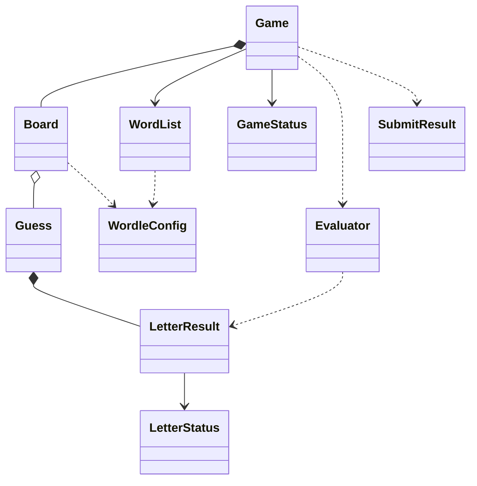

# 🟩 Wordle en español

Un clon de Wordle en **Python + Streamlit**. El juego saca una palabra secreta de
5 letras y tienes 6 intentos. Cada intento devuelve verde, amarillo o gris para
cada letra, y las letras repetidas se cuentan bien.

## Run it

```bash
uv sync --extra dev
.venv/bin/python -m streamlit run app.py
```

O sin `uv`, como en los otros proyectos de esta carpeta:

```bash
python3 -m venv .venv
.venv/bin/pip install streamlit
.venv/bin/python -m streamlit run app.py
```

## Test and lint

```bash
.venv/bin/python -m pytest      # 115 tests, no browser needed
.venv/bin/ruff check .
.venv/bin/ruff format .
.venv/bin/python tools/check_words.py   # audits the two data files
```

`tests/test_ui.py` drives the real Streamlit script headlessly through
`streamlit.testing.v1.AppTest`, so the UI is covered too: the 6×5 grid, the 27
keys, a rejected guess, a win, a loss and "play again".

## Architecture

Las reglas nunca importan Streamlit; la interfaz nunca calcula nada. La función
que puntúa un intento es pura y se testea sola.

```
app.py                     5 lines: streamlit run app.py
ui.py                      the only module that imports Streamlit
wordle/
├── config.py              WordleConfig: word length, attempts, data paths
├── domain.py              LetterStatus, LetterResult, Guess, GameStatus
├── evaluator.py           evaluate() — the pure scoring function — and merge()
├── board.py               Board: the 6x5 grid
├── words.py               normalise(), WordList, reading data/*.txt
├── game.py                Game + SubmitResult: the engine
└── messages.py            every string the player reads, in Spanish
data/
├── secrets_es.txt         264 possible answers
└── valid_es.txt           784 accepted guesses
tools/                     check_words.py, ingest.py, prune.py
tests/                     115 pytest tests, engine + UI
```



## Repeated letters

This is the only genuinely tricky part of Wordle, and it is two passes with a
budget of letters still unspent:

```python
budget = Counter(secret)

# 1. Greens first: every letter sitting in its own spot claims one copy.
for i, letter in enumerate(guess):
    if letter == secret[i] and budget[letter] > 0:
        results[i] = CORRECT
        budget[letter] -= 1

# 2. Yellows left to right, only while a copy is left to claim.
for i, letter in enumerate(guess):
    if results[i] is ABSENT and budget[letter] > 0:
        results[i] = PRESENT
        budget[letter] -= 1
```

Order is the whole answer. `LLAMA` against `SILLA`:

| Guess | Secret | Marks             | Why                                     |
|-------|--------|-------------------|-----------------------------------------|
| `LLAMA` | `SILLA` | 🟨 🟨 ⬛ ⬛ 🟩   | the green `A` spent the secret's only `A` |

The green `A` at the end claims the single `A` the secret owns, so the `A` two
places earlier cannot be yellow. Reversing the passes would answer 🟨 🟨 ⬛ ⬛ 🟩 as
🟩 🟨 ⬛ ⬛ ⬛, which is wrong.

More cases in `tests/test_evaluator.py`, including `OSOAS`/`ARROZ` (three of a
letter for two copies) and `RRRPP`/`PERRO` (a green in the middle).

## Accents and the enye

The brief asked for a decision, so here it is:

- **Accents are folded away before anything is compared.** `CANCIÓN` is stored
  and compared as `cancion`. So you may type either, and the board and keyboard
  never need a tilde key.
- **`ñ` is a letter, not an accent, and it stays.** This is why the
  normalisation maps the five vowels by hand instead of using `unicodedata`:
  `NFD` splits `ñ` into `n` plus a combining tilde, and stripping "accents" that
  way would quietly turn `sueño` into `sueno`. `SEÑOR`, `CAÑÓN`, `SEÑAL`,
  ` DUEÑO`, `AÑEJO`, `TEÑIR`, `REÑIR` and `CEÑIR` are all playable, and `ñ` has
  its own key.
- Guesses are case-insensitive and trimmed, so `"  Limón "` is accepted.

## Word lists

| File            | Words | Role                                    |
|-----------------|-------|-----------------------------------------|
| `secrets_es.txt`| 264   | the answer is drawn from here            |
| `valid_es.txt`  | 784   | every guess is checked against this      |

784 guesses for 264 secrets is playable but on the harder side — a real Wordle
Spanish clone tends to sit nearer 2000–3000 guesses. **These lists were written
by hand, because this machine has no Spanish dictionary** (no `wordfreq`, no
`hunspell`, no `/usr/share/dict` in Spanish). Consequences, stated plainly:

- coverage skews towards common, everyday words; regionalisms are missing;
- a few entries are uncommon in everyday Spanish (`talco`, `quiza`, `tordo`);
- neither list is a substitute for a curated corpus.

`tools/check_words.py` audits both files: every entry is exactly five letters of
`a-z` plus `ñ`, no duplicates, every secret is also a legal guess. `tools/ingest.py`
filters candidate words the same way if you want to add a batch safely, and
`tools/prune.py` removes words by hand. Drop in a better corpus and nothing in
the code needs to change.

92 of the 264 secrets contain a repeated letter, so the tricky path gets
exercised in roughly a third of games.

## Tuning

Everything below lives in `wordle/config.py`.

| Parameter      | Value                                    |
|----------------|------------------------------------------|
| Word length    | 5                                        |
| Attempts       | 6                                        |
| Marks          | green > yellow > grey, and never backwards |
| Keyboard       | 27 keys, `ñ` included, best mark wins     |
| Validation     | length → letters → dictionary, in that order |
| Data files     | `data/secrets_es.txt`, `data/valid_es.txt` |

## Rules as implemented

1. A secret of 5 letters is drawn at random from `secrets_es.txt`.
2. Six attempts, one row each.
3. Green = right letter, right place. Yellow = in the word, wrong place.
   Grey = not in the word.
4. A letter is only marked as many times as it appears in the secret; greens are
   spent before yellows, and yellows are handed out left to right.
5. A guess is rejected, and costs nothing, when it is not 5 letters, contains
   non-letters, or is not in the dictionary. Each case gets its own message.
6. Guessing the secret wins; six wrong guesses lose and reveal the answer.
